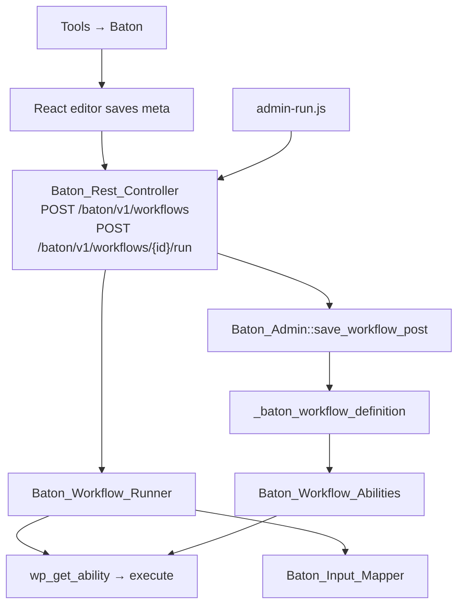

# Baton — agent guide

Baton is a WordPress plugin that chains [Abilities API](https://developer.wordpress.org/apis/abilities/) abilities into saved workflows. Admins compose workflows in **Tools → Baton** in a node canvas or a stack view, run them from the admin, and each published workflow is also registered as its own ability (`baton/workflow-{post_id}`) for nesting and external tooling.

## Requirements

- WordPress **6.9+** (Abilities API: `wp_get_abilities`, `wp_get_ability`, `wp_register_ability`)
- PHP **7.4+**
- Node/npm only when changing the React editor (`src/`)

## What we built

### Core concepts

| Concept | Implementation |
|--------|----------------|
| Workflow storage | CPT `baton_workflow` (no public UI); definition in meta `_baton_workflow_definition`, editor layout in `_baton_editor_layout` |
| Step execution | `Baton_Workflow_Runner` — sequential steps via `WP_Ability::execute()` |
| Data between steps | **Data filters** (`input_mappings`) on edges between nodes; dot-path extraction via `Baton_Input_Mapper` |
| Workflow-as-ability | `Baton_Workflow_Abilities` registers `baton/workflow-{id}` under category `baton-workflows` at `wp_abilities_api_init` only (see WP 6.9 note below) |
| Nested workflows | Runner passes a `workflow_stack` and rejects cycles |
| Admin catalog | `Baton_Ability_Catalog` + `Baton_Schema_Paths` expose schemas, I/O summaries, and mappable paths to JS |

### Workflow definition (meta JSON)

```json
{
  "initial_input": {},
  "steps": [
    {
      "ability": "plugin/ability-slug",
      "input": {},
      "use_previous_output": false,
      "input_mappings": [
        { "source": "previous", "path": "0.plan_id", "target": "plan_id" }
      ]
    }
  ]
}
```

- **`input`**: static JSON merged into the step (edited per step in the editor).
- **`use_previous_output`**: legacy flag; runner still honors it when no mappings exist.
- **`input_mappings`**: maps from `initial` (step 1 only) or `previous` step output via dot paths into ability input fields. Scalar abilities use an empty `target` and path-only rows.
- Sanitization: `Baton_Workflow_CPT::sanitize_definition()` + `Baton_Input_Mapper::sanitize_mappings()`.

### Execution flow


Hooks: `baton_before_step`, `baton_after_step` (see `class-workflow-runner.php`).

### WP 6.9 ability-registration note (important)

`wp_register_ability()` **only works while `wp_abilities_api_init` is firing** — outside that action it is a `_doing_it_wrong` no-op (verified in WP 6.9 core: `doing_action( 'wp_abilities_api_init' )` gate). Consequences:

- `Baton_Workflow_Abilities::register_workflow_ability()` (called at save time from `persist_workflow()` and the `save_post` hook) is intentionally **deferred-ish**: under 6.9 the new `baton/workflow-{id}` ability only appears after the **next request's** registry init, not immediately after save.
- Tests touching workflow saves must expect these notices via `$this->setExpectedIncorrectUsage( 'wp_register_ability' )` / `'WP_Abilities_Registry::unregister'` — see `tests/php/Test_Rest_Save_Workflow.php` (the REST tests follow the same pattern).
- Do not "fix" this by calling `wp_register_ability` directly against the registry mid-request; the gate is core policy.

### Admin UI

- **List** (`includes/admin/class-workflow-list-table.php`): hero banner (`assets/images/baton-banner.png`), search, `WP_List_Table` (DataViews deferred until core default).
- **Edit** (`includes/admin/class-admin.php`): title/excerpt form (`#baton-form`) + hidden fields `workflow_definition` and `baton_editor_layout` synced from React; abilities/definition/layout bootstrapped as JSON in script tags plus a `window.BatonEditor` config (REST save URL, wp_rest nonce, post ID, strings).
- **Run** (`assets/admin-run.js`): POSTs to `Baton_Rest_Controller::run_url()`, displays step-by-step report.
- **Save paths**: the classic form POST (`handle_save_post`) and the REST endpoint (`Baton_Rest_Controller::handle_save`) both funnel into `Baton_Admin::save_workflow_post()` → `persist_workflow()`, which writes definition + pruned layout and re-registers the ability when published.
- **REST endpoints** (`includes/class-rest-controller.php`, namespace `baton/v1`): `POST /baton/v1/workflows` (save; JSON body, same fields as the form POST, returns `{post_id, edit_url, message}`) and `POST /baton/v1/workflows/{id}/run` (JSON body `{initial_input}`; returns the full runner report `{success, steps, error}` — step failures stay HTTP 200 in-band, request-level failures use 400/403/404). `check_permissions()` requires `manage_options`, plus a valid `X-WP-Nonce` (`wp_rest`) for cookie-authenticated requests, matching core's `rest_cookie_check_errors()` semantics.
- **REST save UX** (`src/editor/Shell.js`): modal Done/Close buttons become **Save** when the modal is dirty; a modal save persists the *whole* workflow over `POST /baton/v1/workflows` (JSON body + `X-WP-Nonce`, no page reload), closes the modal only on success, and reports via a `@wordpress/components` `Snackbar`. The DOM submit fallback stays wired for non-JS.

### Editor views (Phase 0–3)

The editor ships two synced views behind a `ToggleGroupControl`; `baton_editor_mode` filter sets the default (node):

- **Node canvas** (`src/editor/NodeView.js`): `@xyflow/react`; ability nodes with I/O chips + loop panel, a data-filter connector node, and an `inputNode` for `initial_input`. Drag from the library or drop onto an edge to insert between steps; Remove re-links neighbors; linearity enforced by `isValidConnection` (single chain — DAG is a future, separate design).
- **Stack view** (`src/editor/App.js`): vertical step cards with data-filter slots; permanent, first-class fallback.
- **Shell** (`src/editor/Shell.js`): owns saving, modal routing, snackbar, the view toggle, and the hidden-field contract (`BatonEditorSync` serializes definition/layout into the DOM fields from whichever view is active).
- **Layout**: node positions persist in `_baton_editor_layout`, pruned to definition ids; the hidden field is seeded server-side from stored layout so stack-view saves keep positions.

## Project layout

```
baton.php                 # Bootstrap, constants, requires
includes/
  class-plugin.php        # Singleton, abilities gate, activation
  class-workflow-cpt.php  # CPT + meta get/save/sanitize (definition + layout)
  class-workflow-runner.php
  class-workflow-abilities.php
  class-input-mapper.php  # Dot paths, scalar vs object input
  class-schema-paths.php  # I/O summaries, path catalogs for UI
  class-ability-catalog.php
  class-rest-controller.php  # POST /baton/v1/workflows[/{id}/run]
  admin/
    class-admin.php       # Menu, edit/list, enqueue, save (form POST + shared helper), run panel
    class-workflow-list-table.php
src/
  index.js
  editor/Shell.js         # Editor shell: saving, modals, view toggle
  editor/NodeView.js      # Node canvas (@xyflow/react)
  editor/components.js    # Shared modals (data filter, I/O detail, loop)
  editor/App.js           # Stack view UI
  editor/utils.js         # Steps, mappings, grouping helpers
build/                    # Compiled editor (run npm run build after src changes)
assets/
  baton-editor.css        # Editor + snackbar styles (lint: npm run lint:css)
  admin.css               # List/run styles
  admin-run.js
  images/baton-banner.png
tests/
  bootstrap.php           # wp-env phpunit bootstrap
  php/                    # Test_* classes (incl. Test_Rest_Save_Workflow)
  php/fixtures/           # Registered test abilities for integration tests
```

## Development commands

```bash
cd wp-content/plugins/baton   # or clone path
npm install
npm run build                  # after any src/ change
npm start                      # watch mode while editing UI
npm run lint:js
npm run lint:css               # stylelint via wp-scripts lint-style
composer install
npm run check                  # static only (matches php-lint + js CI jobs)
npx wp-env start               # Docker required
npm run test:php               # wp-env phpunit (80 tests)
```

PHP: no separate build step. Use strict types (`declare(strict_types=1);`) and match existing `Baton_*` class style.

## Conventions for agents

1. **Minimize scope** — Baton is a thin orchestration layer; avoid reimplementing ability logic that belongs in other plugins.
2. **Abilities API first** — Gate features on `function_exists( 'wp_get_abilities' )`; do not assume abilities from specific plugins except in docs/examples.
3. **Editor changes** — Always run `npm run build` and commit updated `build/` if the repo ships prebuilt assets.
4. **Select controls** — Use native `<select>` + `<optgroup>` for grouped ability lists; use `SelectControl` only for flat option lists (e.g. mapping source/target).
5. **Secrets** — Never commit API keys; workflow definitions may contain site-specific static input.
6. **Tests** — `composer test` via wp-env (`npm run test:php`); manual smoke: save workflow, run from edit screen, nest `baton/workflow-{id}` in another workflow.
7. **WP 6.9 registration gate** — Save-time ability registration is a `_doing_it_wrong` no-op outside `wp_abilities_api_init` (see the note above); when writing tests around workflow saves, expect those notices and don't assert the ability exists immediately after save.
8. **CSS** — `npm run lint:css` uses `wp-scripts lint-style`; stylelint fixes are safe (`lint-style --fix`). Dead selectors: verify against `src/`, `includes/`, `admin-run.js`, *and* `build/index.js` before removing (modifiers can be built dynamically).

## Known gaps / roadmap

- Workflow-level **initial input → step 1 data filter** in the editor (runtime supports `initial_input`; UI exposure is limited).
- Run-report node badges on the canvas (admin-run.js results mapped onto nodes by step id).
- Per-browser editor-view preference (node|stack) via localStorage; `baton_editor_mode` filter sets the default only.
- **External workflow execution** — the `baton/v1` REST routes serve the admin; exposing workflow abilities for external tooling is a separate decision (flip `show_in_rest` on workflow abilities so core's `/abilities/v1/{name}/run` route serves them; changes external attack surface).
- CLI & Command Palette integrations for "external" workflow execution.
- ActionScheduler integration for scheduling step/workflow execution.
- Database/transient integration for persisting workflow output.
- Advanced drag-and-drop workflow building UI.
- Code snippet nodes for fully custom data processing.
- Mapping auto-suggest from schema paths.
- Replace list table with DataViews when appropriate in core.
- User-facing copy pass on mapper warning strings.

## Related docs

- [README.md](README.md) — install, usage, build instructions
- [CONTRIBUTING.md](CONTRIBUTING.md) — PR checks, `npm run check`, build/test commands
- [readme.txt](readme.txt) — WordPress.org plugin directory format
- [docs/wordpress-org-review.md](docs/wordpress-org-review.md) — directory guideline pre-flight
- [LICENSE](LICENSE) — GPL-2.0-or-later
